# Content Agent 0.9.0 — Stage 1 (no GPU / no LLM)

Status: installed on staging; Content/Research temporary-table tests and mock HTTPS ingestion PASS; admin/protection finish pending. This specification explicitly authorizes Content Stage 1 despite the documented remaining Research 0.8.2 limitations. It does not authorize model loading, public Ollama, content publication or changes to collectors.

## Architecture analysis

Research remains an independent CLI/systemd ingestion service with bounded HTTPS collectors, shared MariaDB storage, evidence hashes and a capability/nonce-protected editorial queue. The current `cdra_discovery_handoff(50)` / `wp cyberdat-research discovery_export` contract is CLI-only and read-only: only `ready_for_content_agent` records whose `approved_hash == content_hash` are exported. It includes topic, subject, categories, metadata, references and caveats, not complete article text. It lacks stable item IDs and a full topic evidence hash; the Content plugin adds a **read-only adapter**, without altering that contract or Research files.

The adapter reads the exact selected item and at most 20 topic references, captures their immutable content hashes and normalizes a bounded metadata brief. Selecting a Research item remains a separate human action in Research Queue. Importing does not alter that selection. A changed topic/source hash must be reviewed again; no collector waits for a model or a worker.

```mermaid
flowchart LR
  S[Official sources] --> R[Research ingestion on VPS]
  R --> Q[Research Queue / human selection]
  Q --> C[Content Queue / immutable evidence brief]
  H[Home PC worker] -->|Outbound HTTPS pull / Basic Auth + separate worker key| C
  C -->|Bounded leased job| H
  H --> M[Mock adapter only in Stage 1]
  M -->|Outbound HTTPS result| V[Versioned TEST MOCK draft in Content DB]
  V --> U[Human review / Content Queue]
  U --> A[Approved or Rejected / never Published]
```

No VPS-to-home connection, home port, DNS change or Ollama request is needed. A single POST worker endpoint on existing staging HTTPS is behind existing Nginx Basic Auth plus a separate 256-bit key in headers. TLS certificate/hostname verification is mandatory; arbitrary origins, proxies and redirects are not accepted by the worker. The only server key representation is a SHA-256 verifier in root-controlled `/var/lib/cyberdat-staging/content/worker.json`, readable by the staging PHP group. The owner-only bootstrap file is outside Git and the public webroot. Keys/passwords are never arguments or logged request bodies. Revocation: set `enabled:false` or rotate the worker verifier/bootstrap. No new service, port, Research timer, WP-Cron hook or security exception is installed.

## Queue and storage

Four additive InnoDB tables use `stg_cdca_`, separate from all Research tables: `jobs`, `versions`, `events`, `agents`.

`Selected → Queued → Processing → Draft Ready → In Review → Approved / Rejected`.

Human transitions have capability, nonce, server-side state validation and optimistic revision checks. A worker can only claim, heartbeat, fail or submit a result; it cannot approve or publish. There is no `wp_insert_post`, `wp_update_post`, publication REST route or post-export operation. Drafts are structured JSON in Content tables, not WordPress posts. Even an Approved TEST remains a TEST fixture.

Jobs are deduplicated by topic/template/evidence hash; an active job with another hash for the same topic/template blocks a conflicting selection. Versions have unique submission keys and monotonically increasing version numbers. A repeated completion acknowledgement cannot create another version. Named selection locks and row transactions protect claims/transitions; stale leases/results are rejected. Real Research eligibility is rechecked for human queue/approval and completion.

Stage 1 server and worker both enforce **mock-only**. The worker only claims `is_test=1`; real Research selections can be imported/queued for future work but are never processed by the mock adapter. The single acceptance fixture uses `example.invalid`, is conspicuously synthetic and never claims to be a verified source or article.

Claims have a 180-second lease, heartbeats have a bounded lifetime, retries back off and stop after three attempts. Expired leases are recovered at the next worker claim; no continuously running VPS cleanup daemon is needed while the PC is off. UI shows expired leases and retry exhaustion. Requeueing for another editorial revision is human-controlled, not an infinite retry. Limits: 1000 jobs, 10 immutable versions per job, 20 authenticated requests/minute per configured worker, 20-row admin pages and bounded history display. No automatic history deletion; an owner-reviewed archival policy is needed before these caps are reached.

## Worker and future Ollama

`worker/content/worker.py` uses the Python standard library. `--once` is the default execution unit; `--iterations` is bounded at 100 with 30-second idle intervals. Network calls have 20-second timeouts, at most three attempts and bounded Retry-After. An owner-only local spool preserves a submitted result across a network failure; replay uses the same submission ID. Stale lease replays are discarded safely after explicit server rejection. The POSIX mode is 0600; Windows writes apply an explicit current-user ACL before secret bytes are written.

The adapter interface is `generate(brief, settings) -> structured document`. Five templates share required English sections: title, summary, confirmed source-linked facts, technical analysis, practical recommendations, sources and uncertainties. Template-specific editorial instructions are documented in `templates.md`. Configuration prepares model identifier, temperature, output budget and generation timeout. The mock does not interpret these as real inference parameters. `OllamaAdapter` fails closed and performs no network call; selecting `adapter:ollama` is rejected.

No accessible home address/private tunnel or running home process was supplied/discovered in project configuration. Therefore existing home Ollama, model inventory, GPU presence and GPU performance are **UNVERIFIED**, not assumed. Do not scan private addresses or start/download a model. Future setup should keep Ollama loopback-only on the home PC, let the worker call it locally and continue making only outbound authenticated HTTPS requests to staging. If an off-host LLM is ever needed, require a separately authorized private VPN/SSH channel, never a public 11434 listener.

Future Research intelligence can reuse the adapter boundary with a separate analysis task/result schema. It must produce review proposals, not modify verified source facts, automatically select evidence or become a dependency of collection. It is not implemented/enabled in Stage 1.

## Quality and prompt injection

Automatic checks validate shape, required sections, source-ID/link membership, known CVE membership, output size, prohibited active content, explicit mock labeling and duplicate sentences. Quotes are unsupported in Stage 1. Stored quality results explicitly mark semantic truth, source/publication dates and quotation veracity as **not verified**. Source linkage is not proof that an assertion follows from the source.

A fixed system policy and serialized untrusted-evidence field separate instructions from source metadata. No browsing, tool execution, shell commands, callbacks or source URL fetches are available to the adapter. The mock ignores an injected fixture instruction, as tested. These boundaries are not a claim that a future LLM is immune to prompt injection. Human review must compare claims/quotes/dates against primary sources, distinguish analysis from supported facts, flag unsupported claims and reject incomplete evidence. Feed summaries are not licensed full text; no new scraping is enabled.

## Acceptance and deployment

Offline: PHP contract/QC tests, Python worker tests and existing Research/Threat UI regression tests. On staging after private SQL backup: additive plugin activation, isolated TEMPORARY-table database tests (Content + existing Research/discovery), a read-only Research handoff probe, one real HTTPS mock claim/heartbeat/submission, admin login/Content Queue/Research Queue checks, protected public routes, SQL Dashboard comparison, checked log indicators and protected code/config/timer hashes. No real Research item is selected or changed for acceptance. No WordPress post is created.

The owner-run controller validates passwords before mutation. It uses exact bundle hashes, creates a private backup first and refuses blind reapply. `--resume BACKUP` finishes known partial state. `--verify BACKUP` repeats bounded acceptance (including temporary-table tests and an idle mock worker call), **not a read-only probe**. `--rollback-code BACKUP` disables worker auth and deactivates only Content; data/audit and Research remain intact. It never automatically restores the SQL dump or destroys partial evidence.

Home-PC transport, real browser UI and real LLM integration remain UNVERIFIED until separately observed. The controller's HTTPS test runs the exact CPU mock worker on the VPS; it proves protocol/storage, not connectivity from the home PC. Do not label those unobserved checks PASS.

## Owner-run installation and menu-order continuation — 2026-11-10

Original runtime commit: `727b56be04f590e65ca7b967838cd753ef38b8f9`. Original backup: `/var/backups/cyberdat-staging/content-0.9-20261110T181827Z`.

Owner output confirms 25 Content TEMPORARY-table checks, existing Research database checks, 11 discovery checks, read-only Research handoff with zero selected items, and one real HTTPS mock worker result (job 1 / version 1). No real Research item was selected and no post was created by the tests. The controller then stopped at the Content admin page check, before claiming final protection/regression PASS.

Confirmed cause: WordPress activation sorts active plugins, so Content can register its `admin_menu` callback before Research. At equal priority 10, the submenu is created before its CyberDat parent; WordPress records `admin_page_cyberdat-content`, then later checks `cyberdat_page_cyberdat-content` and denies access. The regression test executes installed WordPress hook/menu/access code without DB/bootstrap and reproduces that mismatch. Registering only the Content submenu at priority 20 fixes both plugin-load orders; unauthorized access remains denied.

`finish-content.py --finish BACKUP` validates the original immutable bundle, SQL backup and protected baselines, snapshots the prior admin file under that backup, patches only `includes/admin.php`, verifies the already saved mock draft without running it again, then completes login/Content Queue/Research Queue/protected-route/worker-denial/log/hash checks. No migration, activation, new credential, fixture creation, worker run, timer operation or model call. Final live acceptance remains pending owner output.

After this one-file correction the original controller correctly rejects a mismatched old plugin tree. Do not rerun `--apply` or the original `--resume`. The pinned finish controller is idempotent for its two known admin hashes. Its `--disable-content BACKUP` safely disables worker auth and deactivates only Content while retaining all Content tables and audit, without restoring SQL or touching Research.
